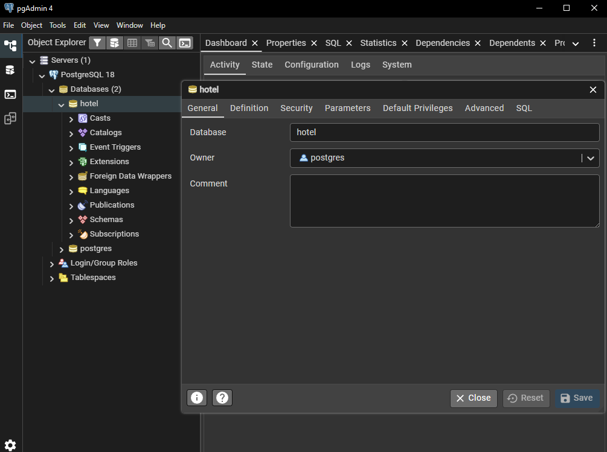
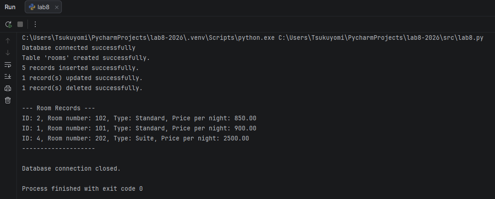

# Звіт до лабораторної роботи № 8

**Тема:** Підключення до бази даних та виконання основних операцій.

**Мета:** здобути практичні навички роботи з базами даних у мові програмування Python, навчитися виконувати базові операції (створення, вставка, оновлення, видалення, вибірка) та ознайомитися з принципами роботи з SQL.

---

## Хід роботи

Було встановлено СКБД PostgreSQL, у pgAdmin створено базу даних `hotel`. 
За допомогою бібліотеки `psycopg2` встановлено з'єднання з БД та створено таблицю `rooms` (id - SERIAL PRIMARY KEY, room_number - INTEGER, room_type - VARCHAR(50), price_per_night - NUMERIC(10, 2)). 
Далі виконано вставку 5 записів, оновлення ціни номера 101, видалення найдешевшого номера та вибірку номерів, тип яких починається на «S», з сортуванням за ціною.

### 1. Скріншоти виконання

*Додайте сюди скріншоти, що демонструють:*
1.  *Створення таблиці у вашій СУБД (наприклад, у pgAdmin).*

2.  *Результат виконання вашого Python-скрипта в терміналі.*

3.  *Вміст таблиці після виконання всіх операцій (SELECT запит у вашій СУБД).*

### 2. Контрольне запитання

*Вкажіть номер вашого варіанту та дайте розгорнуту відповідь на контрольне запитання.*

**Мій варіант:** `6`

**Питання:** `Що таке денормалізація бази даних? У яких випадках вона може бути корисною?`

**Відповідь:**
`Денормалізація - це порушення правил нормалізації бази даних шляхом додавання надлишковості: об'єднання таблиць або дублювання даних для зменшення кількості операцій JOIN і прискорення читання.`

`Вона може бути корисною, коли:`
`- система переважно читає дані, а записи й оновлення рідкісні (звітність, аналітика, сховища даних);`
`- запити з багатьма JOIN занадто повільні на великих обсягах даних;`
`- потрібні агреговані значення, які дорого обчислювати щоразу (наприклад, загальна сума бронювань готелю);`
`- потрібно зберегти історичний стан даних (наприклад, ціну номера на момент бронювання).`

`Недоліки денормалізації: збільшення обсягу даних, ризик неузгодженості (дублі потрібно оновлювати в кількох місцях) та складніша підтримка.`

---

## Висновки

*Опишіть, чого ви навчилися під час виконання цієї лабораторної роботи та які навички здобули.*

`У ході лабораторної роботи було встановлено СКБД PostgreSQL, створено базу даних «hotel» та налаштовано підключення до неї за допомогою бібліотеки psycopg2. Створено таблицю «rooms», виконано вставку, оновлення, видалення та вибірку даних за допомогою SQL-запитів. Здобуто практичні навички роботи з базами даних: використання курсора, підтвердження змін (commit), параметризованих запитів та обробки помилок через try...except...finally. Також розглянуто поняття денормалізації та випадки її застосування.`
